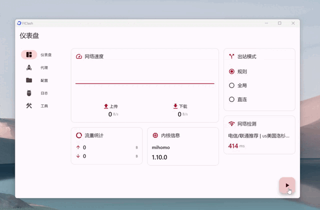
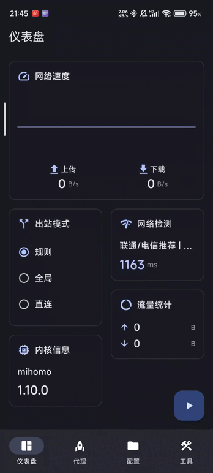

<div>

[**简体中文**](README_zh_CN.md)

</div>

## FlClash

## FlClashTier fork

This fork runs a proxy (mihomo) **and** a ZeroTier private network inside a single
Android `VpnService`, so both work at the same time without two VPN apps fighting
over the one VPN slot. Extra features on top of upstream:

- embedded ZeroTier core inside the same tun (no second VPN service)
- ZeroTier status card (address, network, peer path)
- data path fixes: dedicated TUN writer goroutine with errno classification,
  TCP MSS clamping so segments fit the ZT MTU, layered datapath counters
- one-tap log export that also captures the rolling `zt-datapath.log`

Build history

- `0.9.11+2026111904` **network-switch recovery, properly layered**: `protect()` now returns Boolean through the whole JNI chain and the ZT socket is bound to the *current physical network* (`Network.bindSocket`) instead of only being excluded from our own TUN - a fresh socket after a WiFi<->cellular switch now actually leaves through the live network. When a rebind still does not restore business frames, the watchdog escalates to a **real ZeroTier node rebuild** (same process, same TUN, same flow router, `nodeGen` 1->2) instead of "restarting the core" that never touched the node. Escalation: 20s frozen -> socket, 45s frozen -> node (max 2, 120s apart), then the Dart layer restarts the core at 150s. Tests `TestG1..G5`, `TestJudgeFrameProgress`, `TestH_WatchdogEscalationChain`
- `0.9.2+2026111701` **ZeroTier physical-path self-healing** (`[ZT-SOCKET]`): the embedded ZT UDP socket is now hot-swapped when the inbound path stalls, so a WiFi<->cellular switch no longer requires restarting the app. The watchdog rebuilds after 60s of outbound traffic with zero inbound (not plain zero inbound, so an idle phone is not mistaken for a dead path); node identity, network membership and the TUN are untouched. Regression test `TestG_SocketRebuild`. Download: https://github.com/ximalu/FlClash/releases/tag/v0.9.2%2B2026111701
- `0.9.1+2026111602` first **release-signed** build (package `com.flclashtier`, RSA 4096) - download: https://github.com/ximalu/FlClash/releases/tag/v0.9.1%2B2026111602
- `0.9.1+2026111601` embedded ZT core 1.16.2, tun writer + MSS clamping, layered counters, datapath log file (debug-signed, package `com.flclashtier.dev`)
- `0.9.0+2026090901` first diagnostic build (TUN write retry with full EIO context)
- `0.8.x` ZeroTier status card, l10n, versionName includes versionCode


[](https://github.com/chen08209/FlClash/releases/)[](https://github.com/chen08209/FlClash/releases/)[](LICENSE)

[](https://t.me/FlClash)

A multi-platform proxy client based on ClashMeta, simple and easy to use, open-source and ad-free.

on Desktop:
<p style="text-align: center;">
    
</p>

on Mobile:
<p style="text-align: center;">
    
</p>

## Features

✈️ Multi-platform: Android, Windows, macOS and Linux

💻 Adaptive multiple screen sizes, Multiple color themes available

💡 Based on Material You Design, [Surfboard](https://github.com/getsurfboard/surfboard)-like UI

☁️ Supports data sync via WebDAV

✨ Support subscription link, Dark mode

## Use

### Linux

⚠️ Make sure to install the following dependencies before using them

   ```bash
    sudo apt-get install libayatana-appindicator3-dev
    sudo apt-get install libkeybinder-3.0-dev
   ```

### Android

Support the following actions

   ```bash
    com.follow.clash.action.START
    
    com.follow.clash.action.STOP
    
    com.follow.clash.action.TOGGLE
   ```

## Download

<a href="https://chen08209.github.io/FlClash-fdroid-repo/repo?fingerprint=789D6D32668712EF7672F9E58DEEB15FBD6DCEEC5AE7A4371EA72F2AAE8A12FD"></a> <a href="https://github.com/chen08209/FlClash/releases"></a>

### Homebrew

```bash
brew tap chen08209/tap
brew install --cask flclash
```

## Build

1. Update submodules
   ```bash
   git submodule update --init --recursive
   ```

2. Install `Flutter` and `Golang` environment

3. Build Application

    - android

        1. Install `Android SDK`, `Android NDK`

        2. Set `ANDROID_NDK` environment variable

        3. Run build script

           ```bash
           dart setup.dart android
           ```

    - windows

        1. Requires a Windows client

        2. Install `GCC`, `Inno Setup`

        3. Run build script

           ```bash
           dart setup.dart windows
           ```

    - linux

        1. Requires a Linux client

        2. Dependencies are auto-installed by setup script, or manually:
           ```bash
           sudo apt-get install -y libayatana-appindicator3-dev libkeybinder-3.0-dev
           ```

        3. Run build script

           ```bash
           dart setup.dart linux
           ```

    - macOS

        1. Requires a macOS client

        2. Run build script

           ```bash
           dart setup.dart macos
           ```

## Star

The easiest way to support developers is to click on the star (⭐) at the top of the page.

<p style="text-align: center;">
    <a href="https://api.star-history.com/svg?repos=chen08209/FlClash&Date">
        
    </a>
</p>
