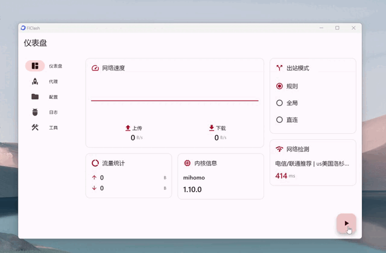
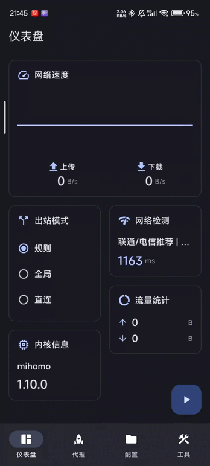

<div>

[**English**](README.md)

</div>

## FlClash

## FlClashTier 分支

这个分支把代理（mihomo）和 ZeroTier 私有网络放进**同一个 Android VpnService**，
两条出口同时工作，不用装两个 VPN App 抢一个 VPN 位。上游没有的能力：

- 同一个 tun 内嵌 ZeroTier core（不占第二个 VPN Service）
- ZeroTier 状态卡（地址、网络、对端路径）
- 数据路径修复：专用 TUN writer goroutine + errno 分类、TCP MSS clamping 让段不超 ZT MTU、分层计数器
- 一键导出日志（会附带滚动的 `zt-datapath.log`）

构建履历

- `0.9.1+2026111601` 内嵌 ZT core 1.16.2、TUN writer + MSS clamping、分层计数、数据面日志文件
- `0.9.0+2026090901` 首个诊断版（TUN 写重试 + 完整 EIO 上下文）
- `0.8.x` ZeroTier 状态卡、多语言、versionName 含 versionCode


[](https://github.com/chen08209/FlClash/releases/)[](https://github.com/chen08209/FlClash/releases/)[](LICENSE)

[](https://t.me/FlClash)

基于ClashMeta的多平台代理客户端，简单易用，开源无广告。

on Desktop:
<p style="text-align: center;">
    
</p>

on Mobile:
<p style="text-align: center;">
    
</p>

## Features

✈️ 多平台: Android, Windows, macOS and Linux

💻 自适应多个屏幕尺寸,多种颜色主题可供选择

💡 基本 Material You 设计, 类[Surfboard](https://github.com/getsurfboard/surfboard)用户界面

☁️ 支持通过WebDAV同步数据

✨ 支持一键导入订阅, 深色模式

## Use

### Linux

⚠️ 使用前请确保安装以下依赖

   ```bash
    sudo apt-get install libayatana-appindicator3-dev
    sudo apt-get install libkeybinder-3.0-dev
   ```

### Android

支持下列操作

   ```bash
    com.follow.clash.action.START
    
    com.follow.clash.action.STOP
    
    com.follow.clash.action.TOGGLE
   ```

## Download

<a href="https://chen08209.github.io/FlClash-fdroid-repo/repo?fingerprint=789D6D32668712EF7672F9E58DEEB15FBD6DCEEC5AE7A4371EA72F2AAE8A12FD"></a> <a href="https://github.com/chen08209/FlClash/releases"></a>

### Homebrew

```bash
brew tap chen08209/tap
brew install --cask flclash
```

## Build

1. 更新 submodules
   ```bash
   git submodule update --init --recursive
   ```

2. 安装 `Flutter` 以及 `Golang` 环境

3. 构建应用

    - android

        1. 安装  `Android SDK` ,  `Android NDK`

        2. 设置 `ANDROID_NDK` 环境变量

        3. 运行构建脚本

           ```bash
           dart setup.dart android
           ```

    - windows

        1. 你需要一个windows客户端

        2. 安装 `GCC`，`Inno Setup`

        3. 运行构建脚本

           ```bash
           dart setup.dart windows
           ```

    - linux

        1. 你需要一个linux客户端

        2. 依赖会由 setup 脚本自动安装，也可以手动安装：
           ```bash
           sudo apt-get install -y libayatana-appindicator3-dev libkeybinder-3.0-dev
           ```

        3. 运行构建脚本

           ```bash
           dart setup.dart linux
           ```

    - macOS

        1. 你需要一个macOS客户端

        2. 运行构建脚本

           ```bash
           dart setup.dart macos
           ```

## Star

支持开发者的最简单方式是点击页面顶部的星标（⭐）。

<p style="text-align: center;">
    <a href="https://api.star-history.com/svg?repos=chen08209/FlClash&Date">
        
    </a>
</p>
